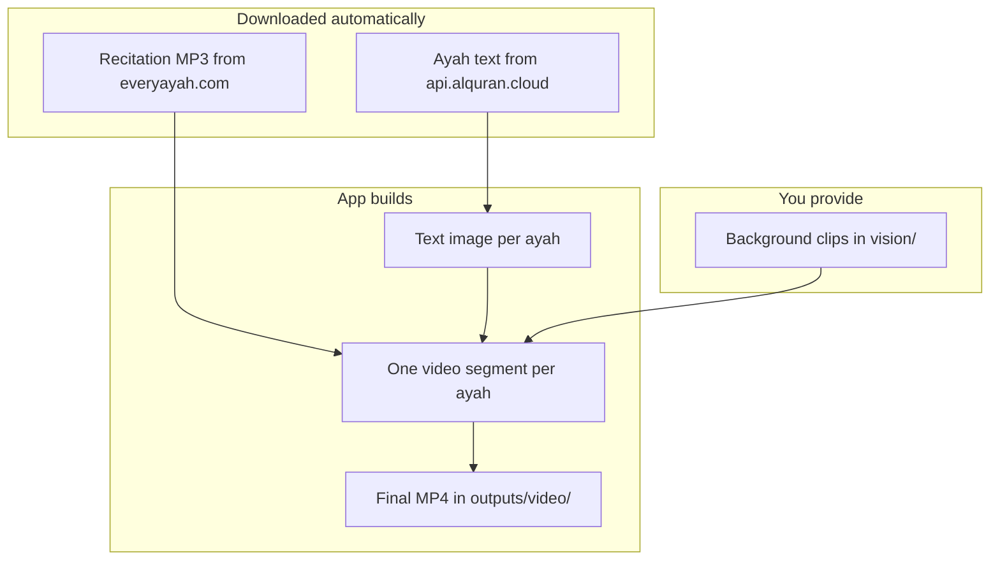
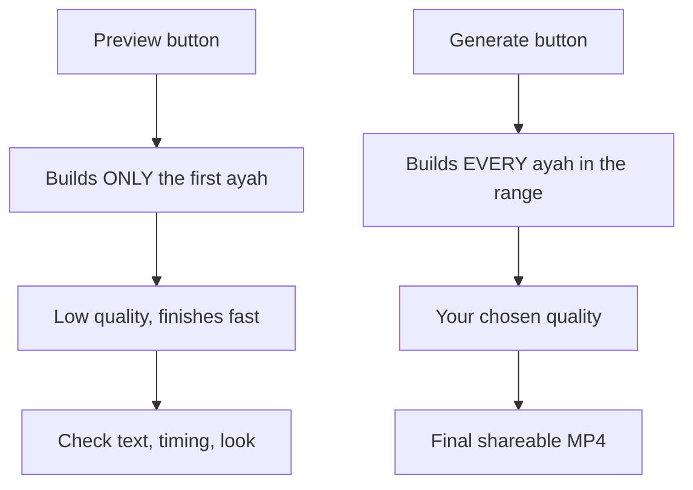

# Quran Reels Generator

<p align="center">
  
  
  
  
</p>

A tool that builds vertical Quran recitation videos (Reels / Shorts / TikTok).
You pick a reciter, a surah, and the ayahs — the app downloads the audio,
renders the ayah text on screen, and merges everything over background video.

**Current version: 0.2.0**

**In 30 seconds:** form in → one MP4 out (`outputs/video/`).


---

## 1. What it can do

| Feature | Plain words |
|---|---|
| Video formats | 9:16 Reels/Story, 1:1 square posts, and 16:9 YouTube |
| Ayah text on screen | The exact verse being recited appears on the video, timed to its audio |
| Word highlighting | On by default; estimates word timing by text length |
| Text position | Bottom of the video, or centered in the middle |
| 12+ reciters | AbdulBasit, Sudais, Minshawy, Shuraym, Husary, and more |
| Background themes | Current folders appear automatically with live previews |
| Preview player | Test one ayah fast, with play/pause, 0.5–2x speed, fullscreen |
| Smart and fast | Audio is cached, backgrounds rotate without repeats, parallel building |

---

## 2. Tools and packages

You need these installed. Each one has a single job:

| Status | Tool | Version | Job |
|---|---|---|---|
| Required | Python | 3.11+ | Runs the app |
| Required | FFmpeg + FFprobe | 6.0+ | Cuts, merges, and encodes the video |
| Auto | Flask 3.0.3 | in `requirements.txt` | The local website + API |
| Auto | Pillow 10.4.0 | in `requirements.txt` | Draws the Arabic text (needs RAQM support) |
| Auto | requests, numpy, dotenv… | in `requirements.txt` | Downloads audio/text, math, settings |
| Auto | Scheherazade New font | bundled in `assets/fonts/` | The Quran-style typeface, already included |

Status: Required = you install · Auto = comes automatically

---

## 3. Installation

Do these steps in order. Copy-paste friendly:

```bash
# 1. Get the code
git clone <repository-url>
cd Quran-Reels-Generator

# 2. Make an isolated Python environment
python -m venv .venv

# 3. Switch it on — Windows:
.venv\Scripts\activate
# ...or Linux / macOS:
source .venv/bin/activate

# 4. Install the Python packages
pip install -r requirements.txt

# 5. Start the app
python main.py

# 6. Open http://127.0.0.1:5000 in your browser
```

### Check that step 5 actually worked

Run these three checks. All must pass:

```bash
ffmpeg -version        # must print a version number (video engine found)
ffprobe -version       # must print a version number (duration reader found)
python -c "from PIL import features; print(features.check('raqm'))"  # must print True (Arabic shaping works)
```

Then open `http://127.0.0.1:5000/api/config` in the browser — you should see
a JSON list of reciters and surahs. If yes, the app is alive.

> FFmpeg lookup order: `QURAN_FFMPEG_EXE` setting → `bin/ffmpeg/` folder →
> system PATH. Any one of the three is enough.

---

## 4. Folders you need to know

Only two folders need your attention. Everything else is automatic:

| Status | Folder | What goes inside |
|---|---|---|
| You fill | `vision/nature/`, `vision/islamic/`, `vision/masjid/`, `vision/night/` | Your background `.mp4` clips, sorted by mood. Without them there is nothing to show behind the text |
| Automatic | `outputs/video/` | Your finished videos land here |
| Automatic | `cache/audio/`, `cache/backgrounds/` | Downloaded recitations + processed clips, so the second run is faster |
| Automatic | `temp/` | Work files, deleted automatically |
| Leave alone | `assets/fonts/`, `quran_reels/`, `specs/` | Font, backend code, feature specs |

### Where do video, audio, and text come from?



- **Backgrounds** come only from your `vision/` folders. The theme decides
  which folder: Ramadan → `night`, Normal → `nature`, Masjid → `masjid`,
  Islamic → `islamic`.
- **Audio** downloads itself per reciter/ayah and is cached, so re-runs are instant.
- **Text** downloads itself (Uthmani script) and is drawn with the bundled font.

---

## 5. Website manual — how to make a video

Open `http://127.0.0.1:5000`. The page has a form on one side and a status
card with the video player on the other.

### Step by step

1. **Your name (optional)** — stamped into the file name only.
2. **Reciter** — pick a voice from the dropdown.
3. **Surah** — type in the search box to find it fast, then select it.
4. **Start / End ayah** — the range to include. The app blocks impossible numbers.
5. **Quality** — Low = fast draft, Medium = everyday use, High = best, slowest.
6. **Visual theme** — choose a folder-backed theme; available folders appear automatically.
7. **Bismillah visual opening (optional)** — replaces the first 1.8 seconds
   of ayah 1 text over its existing audio; it is not audio-synchronized and
   is skipped for Al-Fatihah and At-Tawbah.
8. **Show ayah text** — on by default. Off = plain background video, no text.
9. **Text position** — bottom or middle of the screen (needs step 8 on).
10. **Word highlighting** — on by default. Timing is estimated from word
    length across the ayah; it is not a measured word timestamp from the reciter.
11. **Max duration (optional)** — caps the video length; extra ayahs are dropped.
12. **Recitation speed** — 0.5x slower … 2x faster, pitch unchanged.
13. **Transition style** — choose a gentle crossfade (default), fade through
    black, or a direct cut. Transitions affect video only; recitation audio
    keeps its original timing and duration.
14. **Format** — Reels/TikTok (9:16), Story (9:16), square Post (1:1), or
    YouTube (16:9).
15. Press **Preview** for a quick one-ayah test, or **Generate Video** for the
    full range.

### Preview vs Generate — which button?



### Reading the status card

- **Progress bar + log** — live lines tell you what is happening
  (`text: rendered (112:1)` means ayah 1 of surah 112 got its text image).
- **Player** — appears when the video is ready: play/pause, speed, fullscreen,
  time display. It tries to autoplay; press play if the browser blocks it.
- **Download button** — saves the MP4 from `outputs/video/`.

---

## 6. API (for scripts and developers)

Same website, callable as JSON. Full contract:
`specs/002-ayah-text-sync/contracts/generate-api.md`.

| Method + path | Body | Result |
|---|---|---|
| `POST /api/generate` | reciter, surah, startAyah, endAyah, quality, template, … | Starts a full build, returns `{success}` |
| `POST /api/preview` | reciter, surah, ayah, template | Builds one ayah at low quality |
| `GET /api/progress` | — | `{percent, status, log, output_path, error}` — poll this |
| `GET /api/config` | — | Reciters, surahs, templates |
| `GET /outputs/video/<file>` | — | The finished MP4 |

Useful request fields: `showText` (default `true`), `highlightWords`
(default `false`), `textPosition` (`lower`|`middle`, default `lower`).

---

## 7. If something breaks

| Problem | Fix |
|---|---|
| `ffmpeg not found` | Install FFmpeg 6+ and put it on PATH, or drop it in `bin/ffmpeg/`, or set `QURAN_FFMPEG_EXE` |
| Text looks broken / boxes | RAQM missing — reinstall Pillow so `features.check('raqm')` prints `True` |
| Audio download fails | Check internet; the reciter must exist on everyayah.com |
| Job ends with an Arabic error | Text source unreachable — restore internet and retry (the app refuses silent textless videos on purpose) |
| Slow build | Use Low quality, fewer ayahs, close heavy apps |
| Out of memory | Lower quality, smaller ayah batches |

---

## 8. Go deeper

- [System architecture diagram](.archify/architecture-quran-reels-20261016-151521/quran-reels-architecture.html)
  — interactive map: browser → Flask → build worker → FFmpeg + services.
- [AGENTS.md](AGENTS.md) — contributor notes: commands, config, known traps.
- [Feature spec](specs/002-ayah-text-sync/) — text-sync design, tasks, API contract.

---

## Contributing

1. Fork the repo
2. New branch: `git checkout -b feature/my-idea`
3. Commit with a clear message
4. Push and open a pull request

## License

Apache 2.0 — see [LICENSE](LICENSE).

## Thanks to

- Text: [api.alquran.cloud](https://api.alquran.cloud) (Uthmani script)
- Audio: [EveryAyah.com](https://everyayah.com) + quranicaudio.com mirrors
- Font: Scheherazade New (OFL, bundled) · Backgrounds: yours (check their license)

<p align="center">Made for the Ummah</p>
